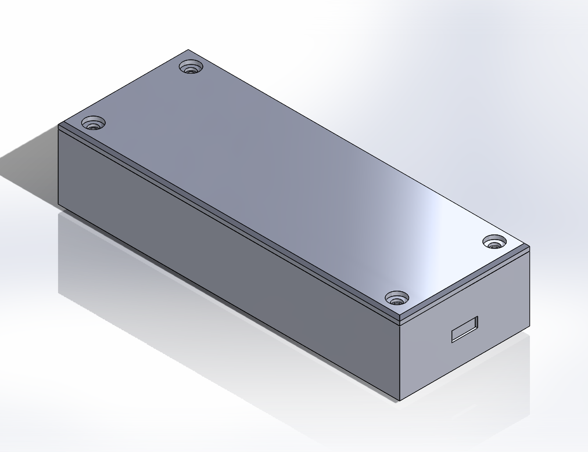

# Power Outage Monitor

An ESP32 mains-outage alarm. A 12 V adapter on the monitored outlet feeds an
LM2596 module whose 3.1 V output drives `GPIO 4`; the ESP32 and the Wi-Fi router
run from a Mini-UPS, and on a mains cut the ESP32 sends an HTTP request that
makes an Android phone (MacroDroid) ring until the alarm is stopped.

```text
12 V adapter -> LM2596 3.1 V -> GPIO 4 -> ESP32 -- Wi-Fi HTTP --> MacroDroid siren
                                               \-- HTTPS (optional) --> ntfy.sh
```

## Features

- Debounced mains sensing; restore needs `GPIO 4` HIGH continuously for `max(debounce_ms, restore_cooldown_ms)`
- `ARMED`, `DISARMED` and `SNOOZED` modes from the web page, the HTTP API or the `BOOT` button
- Local notify URL with an `{event}` placeholder and an optional cloud webhook (`ntfy.sh` format)
- Per-target delivery queue with retries; the latest state event is sent after Wi-Fi returns
- Web page with live state, last delivery result per target, Wi-Fi (5 slots), settings and OTA update
- Setup access point for first configuration; HTTPS targets verified against a Mozilla root CA bundle
- 3D-printed enclosure

## Project structure

| Path | Purpose |
|---|---|
| `firmware/` | PlatformIO/Arduino firmware (`src/`), Unity host tests (`test/`), payload dump (`host/`), CA bundle (`data/cert/`) |
| `hardware/enclosure/` | SolidWorks parts and assembly (`cad/`), print files (`stl/`) |
| `tools/mobile_alarm_sim.py` | Sends firmware-format events to a phone or to `ntfy.sh` from a PC |
| `tools/sim/` | Verification runner, mock device and browser tests |
| `docs/schemas/` | JSON schemas of the event payloads, `/api/status` and `/api/config` |

## Hardware

| Component | Qty | Notes |
|---|---:|---|
| ESP32 DevKit V1, 38-pin, USB-C, CP2102 | 1 | Powered from the Mini-UPS USB port (5 V) |
| LM2596 step-down module | 1 | Output set to 3.0–3.2 V |
| 12 V DC wall adapter | 1 | In the monitored outlet, not on the UPS |
| Resistor 1–4.7 kOhm, 0.25 W | 1 | In series between LM2596 `OUT+` and `GPIO 4` |
| 2-wire DC cable, 4.0 x 2.0 mm flat | 1 | Adapter to LM2596 `IN+` / `IN-` |
| Router Mini-UPS | 1 | Keeps the ESP32 and the router powered during a cut |
| M3 self-tapping screws | 8 | 4x M3 x 8–12 mm (lid), 2x M3 x 6 mm (clamp), 2x M3 x 5–6 mm (LM2596) |

| From | To | Function |
|---|---|---|
| 12 V adapter `+` / `-` | LM2596 `IN+` / `IN-` | Mains indicator |
| LM2596 `OUT+` | Resistor -> `GPIO 4` | Mains sense (`INPUT_PULLDOWN`, HIGH = mains on) |
| LM2596 `OUT-` | ESP32 `GND` | Common ground |

Set the LM2596 output to 3.0–3.2 V with a multimeter before connecting
`GPIO 4`; never above 3.3 V. Only the 12 V DC side enters the case.

The enclosure has three parts, 126.0 x 48.0 x 28.0 mm assembled, printed
without supports (PETG or PLA): `Case_Bottom` (DevKit cradle, two LM2596
bosses), `Case_Lid` and `Cable_Clamp` (strain relief for the 12 V cable).
Solder all leads before mounting the boards; the walls block the iron later.



## Firmware

```bash
pio run -d firmware -e esp32dev
pio run -d firmware -e esp32dev -t upload
pio device monitor -d firmware -b 115200
```

On the first USB flash hold `BOOT` while `esptool` prints `Connecting...`
(auto-reset does not enter the bootloader on every host). `BOOT` is not
reachable once the case is closed; later updates go over Wi-Fi.

### First setup and OTA

1. Join `PowerMonitor-XXXX` (password `12345678`) and open `http://192.168.4.1/`.
2. Save the home Wi-Fi under **Wi-Fi Network**.
3. Under **Setup Access & Maintenance** set an **Admin Password** (Basic auth, user `admin`) and change the setup AP password.
4. Reserve fixed DHCP addresses for the ESP32 and the phone in the router (`.local` names do not resolve reliably on Android).

The setup AP stays open until a network is saved, then opens for
`setup_window_s` on every boot, for 120 s after 5 min without Wi-Fi, and for
5 min from the page. **Firmware Update** uploads a `.bin` (admin password
required); the image is activated only when the request completes, so a failed
or interrupted upload keeps the running firmware.

### Configuration

| Setting | Default | Range |
|---|---|---|
| `wifi[0..4]` | empty | SSID 0–32 B, password 8–63 B or open |
| `local_url` | empty | `http://` or `https://`, up to 256 B, `{event}` allowed |
| `webhook_url` | empty | `http://` or `https://`, up to 256 B, `{event}` allowed |
| `cloud_enabled` | `false` | Sends to `webhook_url` only when `true` |
| `alert_mode` | `0` | `0` outage only, `1` also `POWER_ON` to the cloud |
| `admin_pass` | empty | 8–63 B; required for OTA |
| `ap_ssid` / `ap_pass` | `PowerMonitor-XXXX` / `12345678` | 1–32 B / 8–63 B |
| `setup_window_s` | `60` | 0–600 s |
| `device_name` | `power-monitor` | 1–32 of `[a-z0-9-]`, no leading or trailing `-` |
| `debounce_ms` / `restore_cooldown_ms` | `500` / `5000` | 50–10000 / 0–60000 ms |
| `snooze_default_min` | `30` | 1–1440 min |

Settings are stored in NVS namespace `pwr_mon`. A hardware watchdog of 45 s
supervises the main loop and both notification workers.

### Button and LED

`BOOT` (`GPIO 0`, on release): under 2 s toggles armed, 2–5 s test alarm and
Wi-Fi reconnect, 5–10 s setup AP for 5 min, 10 s or more factory reset.
LED (`GPIO 2`): 5 Hz strobe mains off, else triple flash setup AP open, else
solid `ARMED`, 1 Hz blink `DISARMED`, double blink `SNOOZED`.

## Phone setup

MacroDroid Pro (tested 6.1.5) on the phone, on the same Wi-Fi.

1. Global Boolean variable `pm_alarm_ringing` = `False`.
2. Action Block `Stop alarm`: set `pm_alarm_ringing` = `False`; Stop sounds; Hide Custom Scene `Power is OFF`; Keep Device Awake: disable; Clear Notifications containing `Mains electricity is OFF.`
3. Macro `Power Outage Alarm`, four triggers *HTTP Server Request* on port 8080 with paths `power_off`, `power_on`, `alarm_stop`, `test_alarm`. All four are required: MacroDroid does not answer an unknown path and the device retries it.

```text
If trigger = power_off
    Cancel Macro Actions (this macro, other instances only)
    Volume: Alarm 100%
    Display Notification "Mains electricity is OFF.", channel High priority, persistent,
        Prevent Android 16+ grouping, button "Stop alarm" -> Stop alarm
    Set pm_alarm_ringing = True; Keep Device Awake: screen on, 15 min
    Display Custom Scene "Power is OFF": Full Screen (Activity), show on lock screen,
        all "close on ..." unchecked, button "Stop alarm" -> Stop alarm
    pm_loop = 0
    While pm_alarm_ringing = True AND pm_loop < 450
        Play Sound (Alarm stream, do not block); Wait 2 s (Use alarm); pm_loop + 1
    If pm_alarm_ringing = True: Stop alarm
Else If trigger = test_alarm
    Display Notification "Power monitor test received" (no siren)
Else
    Cancel Macro Actions (other instances only); Stop alarm
```

4. Android settings: MacroDroid channel *Notification action (High priority)* -> Override Do Not Disturb; battery usage **Unrestricted** for MacroDroid (and ntfy); grant Accessibility, Display over other apps, Alarms & reminders, Notifications and Notification access.
5. On the device page set **Local Notify URL (Phone)** to `http://192.168.1.60:8080/{event}` and press **Test Alarm**: the phone shows the test notification and the page shows `Phone: OK`.

**ntfy, when away from home.** Subscribe the ntfy app to a random topic with
*Instant delivery*, enable *Keep alerting for highest priority* and Override Do
Not Disturb on its *Max priority* channel, set **Cloud Webhook URL** to
`https://ntfy.sh/<topic>` and switch **Internet alerts (ntfy)** on only while
away. ntfy rings on its own and is dismissed in the ntfy app.

**Stopping the siren:** **Stop alarm** on the full-screen *Power is OFF* screen
or on the notification, **Disarm** or **Snooze** on the device page (sends
`alarm_stop`), or mains return (sends `power_on`). Swiping the notification away
does not stop it on Android 14+.

**Before sleep:** LED solid on, phone on Wi-Fi and charging, page shows `Phone: OK`.

## API

Port 80. `admin` routes need the header `X-Requested-With: pm-ui` (else `403`)
and, once an admin password is set, Basic auth (else `401`). Errors are
`{"error":"<field>: <reason>"}`.

| Route | Method | Guard | Notes |
|---|---|---|---|
| `/api/status` | `GET` | open | State, Wi-Fi, setup AP, last delivery result per target (`notify.local`, `notify.cloud`) |
| `/api/arm`, `/api/disarm`, `/api/toggle` | `POST` | open | `{"status":"ok","mode":...}` |
| `/api/snooze` | `POST` | open | `?min=N`, `?duration=S`, `{"duration_min":N}` or `{"duration":S}`, empty uses the default; clamps to 1440 min; reply `{"status":"ok","mode":"SNOOZED","remaining_s":N,...}`; `409` when disarmed |
| `/api/test` | `POST` | open | Sends `TEST_ALARM` |
| `/api/config` | `GET`, `POST` | admin | Passwords never returned (`has_*` flags); `POST` is a partial update validated as a whole, `413` above 2048 bytes |
| `/api/scan` | `GET` | admin | `{"status":"scanning"}` or up to 20 networks |
| `/api/setup-ap`, `/api/setup-ap/close` | `POST` | admin | Open for 5 min, close (`400` without a saved network) |
| `/api/reboot`, `/api/factory-reset` | `POST` | admin | Restart; erase `pwr_mon` and restart |
| `/api/update` | `POST` | admin | Multipart field `firmware`; `403` without admin password, `409` while busy |

### Events

| Event | Sent when | Fields besides `event`, `device`, `uptime_s`, `ts` |
|---|---|---|
| `POWER_OFF` | Mains lost while `ARMED` (also at boot), or `ARMED` entered while mains is off | `state`, `grid`, `power`, `armed`, `duration_s` |
| `POWER_ON` | Mains restored, any mode | same plus `alert_mode` |
| `ALARM_STOP` | `ARMED` -> `DISARMED` or `SNOOZED`, snooze restarted | `state`, `snooze_remaining_s` |
| `TEST_ALARM` | Test from the page, API or button | `state`, `grid` (`TEST`), `power`, `armed`, `duration_s` (0) |

`ts` is UNIX time once NTP has synced, otherwise `0`. Bodies are JSON; for host
`ntfy.sh` the three events except `ALARM_STOP` go as plain text with `Title`,
`Priority` (`urgent` for `POWER_OFF`) and `Tags` headers. `{event}` in a URL
becomes the lower-case event name.

Delivery rules:

- `local_url` gets every event. `webhook_url` gets events only when `cloud_enabled`: `POWER_OFF`, `TEST_ALARM`, and `POWER_ON` only with `alert_mode` 1.
- Each target has its own worker and a queue of 4. An event gets 3 attempts with 2 s and 8 s gaps, each after waiting up to 10 s for Wi-Fi; any `2xx` counts.
- `POWER_OFF`, `POWER_ON` and `ALARM_STOP` are state events: a newer one supersedes a queued or retrying older one. Raised while Wi-Fi is down (or failing because Wi-Fi dropped), the event becomes the target's single pending state event at once and the latest one is sent after reconnect; a pending `POWER_OFF` only while mains is still off and the unit is `ARMED`. Attempts that fail with Wi-Fi up are not repeated.
- A full queue evicts its oldest event for a new state event; a new `TEST_ALARM` is dropped and reported as `Queue full`.

## Tests

```bash
pio test -d firmware -e native
python -m pip install -r tools/sim/requirements.txt
python tools/sim/run_all.py            # or --layers L0,L2
```

| Layer | Covers |
|---|---|
| L0 | `esp32dev` build without warnings from `src/`, web page script syntax and ES2017 ceiling |
| L1 | Unity host tests (`test_config`, `test_power_proto`, `test_wifi_ap`) |
| L2 | Payloads and API against `docs/schemas/`, firmware vs mock parity (constants, routes, ntfy headers, config validation cases) |
| L3 | Browser tests of the web page (Playwright) against `tools/sim/mock_device.py` |

Where Windows blocks locally built executables (Smart App Control), run L1 and
L2 in WSL. To test the phone without cutting mains:

```bash
python tools/mobile_alarm_sim.py http power_off --target "http://192.168.1.60:8080/{event}"
python tools/mobile_alarm_sim.py ntfy power_off --topic <topic>
```

## Limitations

- Control routes (`arm`, `disarm`, `toggle`, `snooze`, `test`) are open on the LAN so phone actions need no credentials; the page and Basic auth use plain HTTP.
- The 2048-byte limit of `POST /api/config` is checked after the body has been read.
- The default setup AP password is public until changed.
- Alerts depend on the Mini-UPS keeping the ESP32 and the router powered; there is no alert if the ESP32 itself loses power.
- With two host-name targets or two HTTPS targets, attempts run one at a time, so an unreachable host can delay the other target by up to 39 s per attempt.

## License

[MIT](LICENSE), except `firmware/data/cert/x509_crt_bundle.bin` (Mozilla CA
list, MPL-2.0). The bundle (121 roots) was generated from `certifi` 2026.07.22
`cacert.pem` with ESP-IDF
[`gen_crt_bundle.py`](https://github.com/espressif/esp-idf/blob/f935c17a958d6a8fe3194e743b3d526998341e50/components/mbedtls/esp_crt_bundle/gen_crt_bundle.py);
to refresh it, with `certifi` and `cryptography` installed, run `python gen_crt_bundle.py --input "$(python -c 'import certifi; print(certifi.where())')"`
and copy the output `x509_crt_bundle` to that path.
