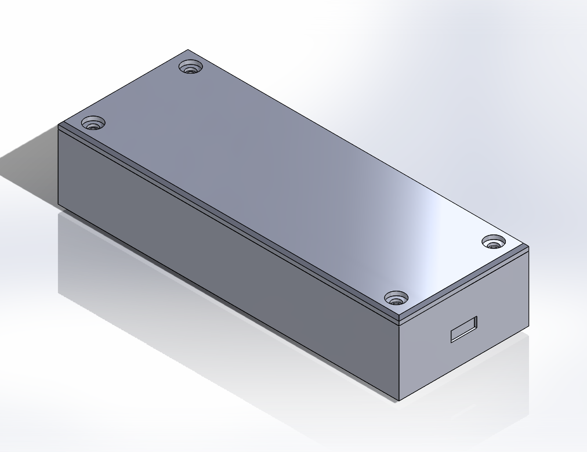
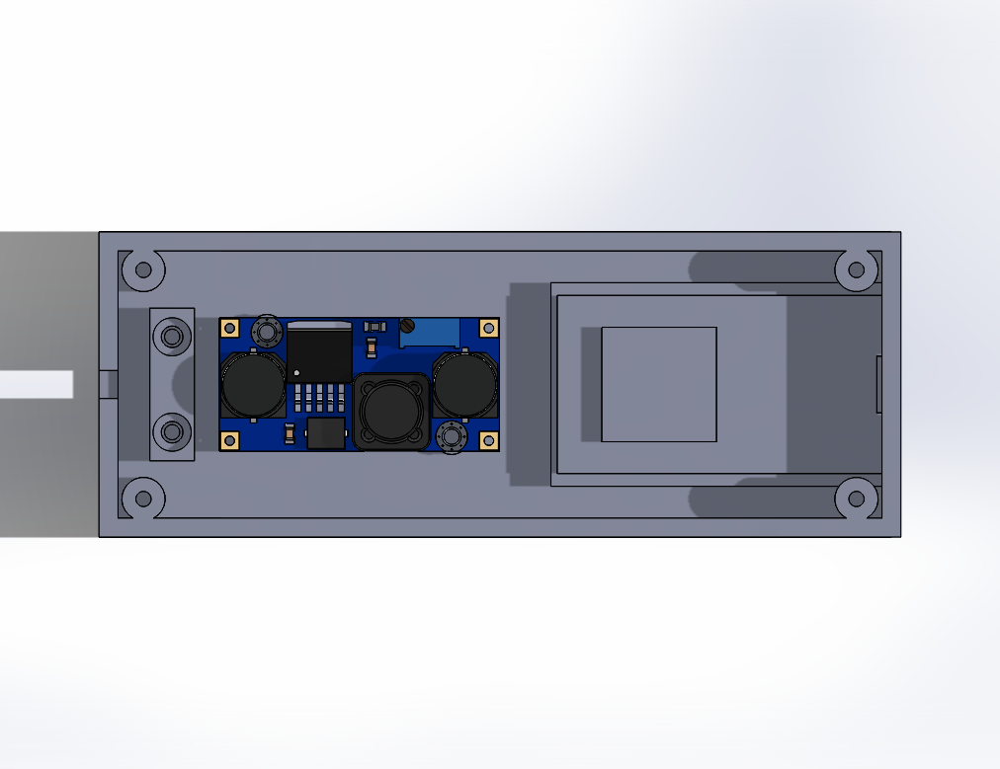
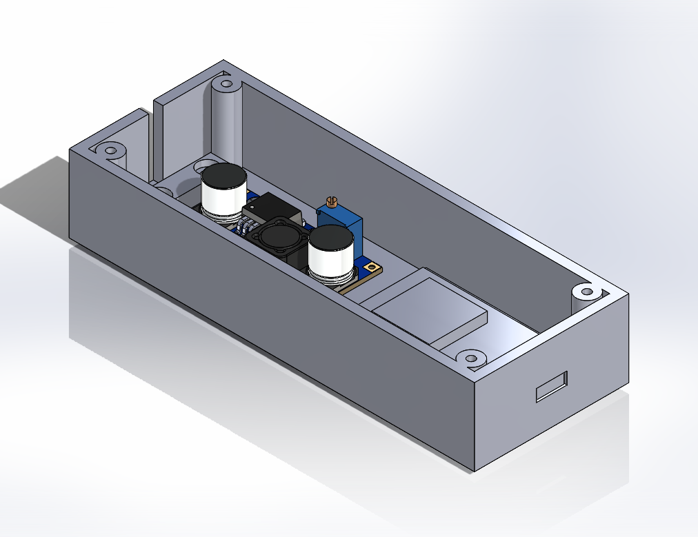

# Power Outage Monitor Enclosure

Parametric 3-part FDM enclosure (`126.0 x 48.0 x 28.0 mm` assembled outer footprint: `25.5 mm` body + `2.5 mm` exposed lid) housing the 38-pin USB-C ESP32 DevKit, the LM2596 step-down module, and a 2-screw cable strain-relief clamp.



## Parts and dimensions

All print-ready STL files in [`stl/`](stl/) are oriented for support-free printing with their bed face at `Z = 0`, 0 bad edges, and 1 manifold shell per part (3 shells on the combined build plate).

| Part | CAD / STEP | Print STL | Bounding box (mm) | Volume | Triangles |
|---|---|---|---|---|---|
| **Case Bottom** | [SLDPRT](cad/Case_Bottom.SLDPRT) / [STEP](step/Case_Bottom.STEP) | [`stl/Case_Bottom.stl`](stl/Case_Bottom.stl) | `126.0 x 48.0 x 25.5` | `43,231.84 mm^3` (`43.23 cm^3`) | `44,474` |
| **Case Lid** | [SLDPRT](cad/Case_Lid.SLDPRT) / [STEP](step/Case_Lid.STEP) | [`stl/Case_Lid.stl`](stl/Case_Lid.stl) | `126.0 x 48.0 x 3.7` (`1.2 mm` lip) | `15,241.15 mm^3` (`15.24 cm^3`) | `24,940` |
| **Cable Clamp** | [SLDPRT](cad/Cable_Clamp.SLDPRT) / [STEP](step/Cable_Clamp.STEP) | [`stl/Cable_Clamp.stl`](stl/Cable_Clamp.stl) | `7.0 x 24.0 x 5.0` | `615.01 mm^3` (`0.62 cm^3`) | `11,556` |
| **Combined Build Plate** | – | [`stl/Power_Outage_Monitor_All_Parts_Plate.stl`](stl/Power_Outage_Monitor_All_Parts_Plate.stl) | `149.0 x 112.0 x 25.5` | `59,088.00 mm^3` (`59.09 cm^3`) | `80,970` |
| **ESP32 Mockup** | [SLDPRT](cad/ESP32_38P_TypeC.SLDPRT) / [STEP](step/ESP32_38P_TypeC.STEP) | – | `52.0 x 28.0 mm` PCB | – | – |
| **LM2596 Mockup** | [SLDPRT](cad/LM2596_module.SLDPRT) | – | `44.0 x 21.0 mm` PCB | – | – |
| **Full Assembly** | [SLDASM](cad/Power_Outage_Monitor_Case.SLDASM) / [STEP](step/Power_Outage_Monitor_Case.STEP) | – | `126.0 x 48.0 x 28.0` | – | – |

Expected board footprints:

- **ESP32 DevKit (38-pin USB-C):** `52 x 28 mm` PCB (`1.6 mm` thick) with centred USB-C port.
- **LM2596 buck converter module:** `44 x 21 mm` PCB with `Ø3.0 mm` mounting holes at `29.0 x 16.42 mm` diagonal pitch.

`stl-assembly-frame/` is an intermediate build folder (gitignored) regenerated when `rebuild_and_verify.py` runs.

## Print settings

Designed for FDM printers (Bambu Lab, Prusa, Creality K1C, Voron, etc.) without supports:

| Setting | Recommended value | Notes |
|---|---|---|
| Material | PETG (recommended) or PLA | PETG offers higher heat and impact resistance near electronics |
| Layer height | `0.20 mm` | `0.20 mm` first layer |
| Wall loops | `4–5` walls | Keeps screw bosses and locating ribs solid |
| Top / bottom shells | `5 / 5` layers | Rigid floor and clean exterior faces |
| Infill | `25%–30%` Gyroid | Isotropic wall and boss stiffness |
| Temperatures (PETG) | Nozzle `240 °C`, bed `70 °C` | Textured PEI sheet |
| Elephant foot compensation | `0.15 mm` | Clean fit on the lid alignment lip (`0.3 mm` radial clearance) |
| Cooling fan | `40%–50%` (`100%` on bridges) | |
| Supports | **None** | All three parts print flat at `Z = 0` |

## Hardware and boss geometry

Use **countersunk or low pan-head** M3 self-tapping screws so heads sit flush in the recesses (standard socket-head cap screws protrude):

| Fastener / feature | Qty | Screw size | Clearance / head recess | Boss & pilot hole |
|---|---:|---|---|---|
| Lid corners | 4 | **M3 x 8–12 mm** (max `14 mm`) countersunk / low pan | `Ø3.4 mm` through; `Ø6.2 x 1.5 mm` deep recess (`1.0 mm` web) | `(+-56.0, +-18.0) mm`, `Ø6.8 mm`, `H = 25.5 mm`, blind pilot `Ø2.4 x 13.0 mm` |
| LM2596 mount | 2 | **M3 x 5–6 mm** (max `6.35 mm`) low pan | `Ø3.0 mm` PCB holes (`29.0 x 16.42 mm` pitch) | `(-36.59, -8.21)` & `(-7.59, +8.21) mm`, `Ø5.6 mm`, `H = 6.5 mm`, blind pilot `Ø2.4 x 5.0 mm` |
| Cable clamp | 2 | **M3 x 6 mm** (max `7.5 mm`) countersunk / low pan | `Ø3.4 mm` through; `Ø6.0 x 2.0 mm` deep counterbore (`2.5 mm` web) | `(-51.5, +-7.5) mm`, `Ø5.6 mm`, `H = 6.0 mm`, blind pilot `Ø2.4 x 5.0 mm` |

The lid (`Ø6.2 x 1.5 mm`) and cable clamp (`Ø6.0 x 2.0 mm`) counterbores print face-down as small circular bridges and may need a light cleanup pass with a `6 mm` drill bit before driving the screws.

## Assembly order





1. **Calibrate the LM2596 first:** Power the module from the `12 V` adapter and adjust its trimmer to `3.0–3.2 V` on `OUT+` / `OUT-` before mounting or wiring the ESP32.
2. **Pre-solder the board leads:** Solder the `12 V` input wires to `IN+` / `IN-` on the LM2596 and solder the `OUT-` -> `GND` and `OUT+` -> `1–4.7 kOhm` series resistor -> `GPIO 4` leads onto the boards **before** seating them in the enclosure, as the side walls and cradle restrict soldering-iron access once mounted.
3. **Clamp the 12 V DC cable:** Route the `4.0 x 2.0 mm` 2-wire cable through the left-wall slot (`4.4 mm` wide) and fasten `Cable_Clamp` with two M3 x 6 mm screws.
4. **Mount the LM2596:** Place the module onto its two bosses with the **IN end** (100 uF input capacitor, 5-pin TO-263 IC, and diode) facing the `-X` cable entry (`3.91 mm` wiring gap to the clamp bar) and the **OUT end** (inductor, trimmer, 220 uF output capacitor) facing the ESP32 cradle (`8.09 mm` gap), then fasten with two M3 x 5–6 mm screws.
5. **Seat the ESP32 in the cradle:** Press the 38-pin DevKit into the right-hand cradle with the USB-C connector aligned to the side cutout.
6. **Close the lid:** The `25.5 mm` body height leaves `6.10 mm` headroom from the LM2596 trimmer to the lid underside (`11.70 mm` above the ESP32 mockup). Seat `Case_Lid` and secure with four M3 x 8–12 mm screws.

## How to regenerate

- **Prerequisites:** SolidWorks 2024 on Windows (`SOLIDWORKS 2024 SP5` verified; `sw_api.py` resolves standard planes by `RefPlane` feature order so it does not rely on English plane names) and Python 3 with [`tools/requirements.txt`](tools/requirements.txt) (`pywin32==312`, `numpy==2.5.3`).

```bash
# Install CAD Python dependencies (outside synced folders)
python -m pip install -r hardware/enclosure/tools/requirements.txt

# Full rebuild: CAD parts, interference & boss-alignment checks, STEP/STL export, 3 renders, print orientation, build plate, and STL gate
python hardware/enclosure/tools/rebuild_and_verify.py

# Re-orient existing assembly-frame STLs only (requires stl-assembly-frame/ produced by rebuild_and_verify.py first)
python -I hardware/enclosure/tools/print_orient.py

# Regenerate combined 3-part build plate STL
python -I hardware/enclosure/tools/build_plate.py

# Run the mesh quality gate (watertight, expected shell count, |bed_min_up| <= 0.01 mm)
python -I hardware/enclosure/tools/stl_gate.py hardware/enclosure/stl/Case_Bottom.stl --up +Z
python -I hardware/enclosure/tools/stl_gate.py hardware/enclosure/stl/Case_Lid.stl --up +Z
python -I hardware/enclosure/tools/stl_gate.py hardware/enclosure/stl/Cable_Clamp.stl --up +Z
python -I hardware/enclosure/tools/stl_gate.py hardware/enclosure/stl/Power_Outage_Monitor_All_Parts_Plate.stl --up +Z --expected-shells 3
```
